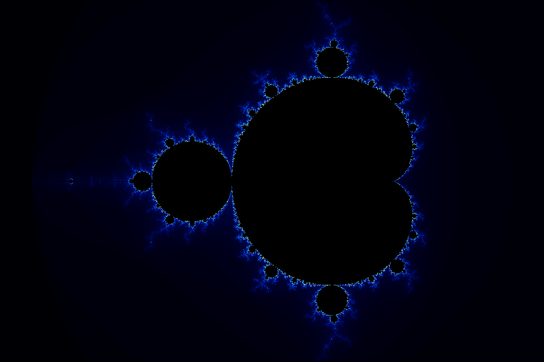
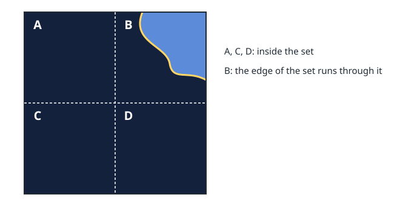
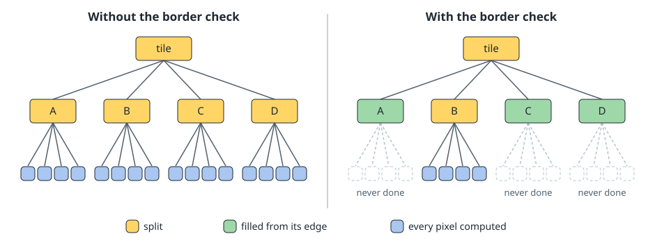
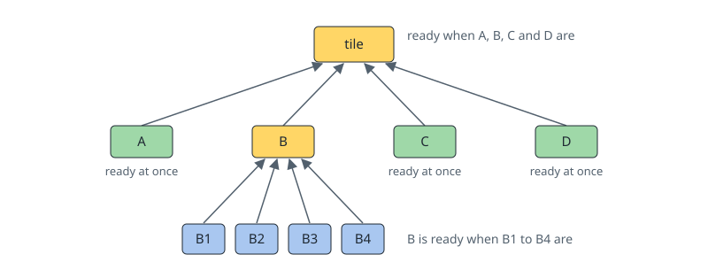
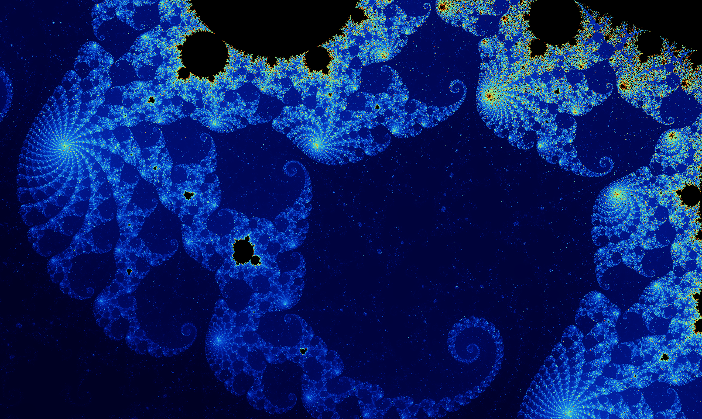
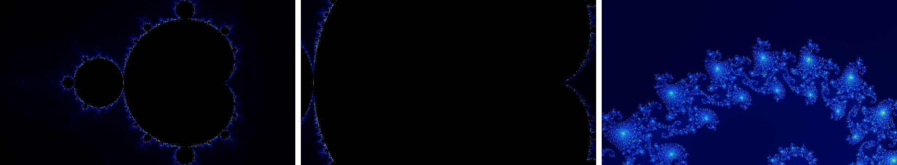

# Mandelbrot set project

This repository contains a Mandelbrot set image generator for the course CS5658 GPU Programming.

Implementation of HPX applications for Mandelbrot set generation, compared with other versions such as sequential and pure CUDA.

## Authors

- Rajdeep 112301045
- Zeeshan Mohammed Rangrej 112301040
- Vishesh Srivastava 112301037
- Rajat Bhootra 112301044

## The Mandelbrot set

The Mandelbrot set $M$ is a set of complex numbers that, when plotted on the Argand plane, produces a fractal. Its boundary reveals new detail at every scale of magnification, including small copies of the whole set.



To define it, take $c \in \mathbb{C}$ and consider the sequence

$$z_0 = 0, \qquad z_{n+1} = z_n^2 + c.$$

The number $c$ belongs to $M$ exactly when this sequence remains bounded.

To test whether $c \in M$, we use the fact that once $|z_n| > 2$, the sequence diverges. The terms are computed up to an iteration limit $N$, and the escape count of $c$ is

$$k(c) = \min \lbrace n < N : |z_n| > 2 \rbrace,$$

with $k(c) = N$ if there is no such $n$. A point with $k(c) = N$ is taken to belong to $M$.

In an image, each pixel is one value of $c$, and its escape count, or simply count, decides its color. Pixels in $M$ are black, and the colors around them show how quickly the points outside escape.

Pixels are independent of one another, which makes the computation easy to parallelise. Their costs, however, are highly uneven: a point far from $M$ escapes within a few steps, whereas a point in $M$ takes all $N$. Distributing the work well is therefore the central problem.

## Implementations

HPX is a C++ library for parallel programming. Work is expressed as tasks, which HPX schedules on a pool of threads. Launching a task returns a future, representing a result that may not yet be available. A tile is a small square of the image.

The image is generated by several implementations on the CPU and on NVIDIA GPUs.

| Version | Description | Program |
|---|---|---|
| 1 | Sequential CPU renderer, the reference for correctness and time | `mandelbrot_sequential` |
| 2 | HPX renderer with one task per pixel, row or fixed-size tile, and parallel loops with different chunk sizes | `mandelbrot_hpx` |
| 3 | HPX renderer that checks tile borders to skip work, with a tree of futures | `mandelbrot_hpx --method border` |
| 4a | Live explorer that draws tiles as they finish, cancels old work and recomputes everything | `mandelbrot_explorer --no-reuse` |
| 4b | Live explorer that reuses earlier work | `mandelbrot_explorer` |
| 5 | CUDA renderer that computes every pixel on the GPU | `mandelbrot_cuda` |
| 6 | Version 3 with the small tiles that cannot be filled computed on the GPU | Not yet |

## The Mariani-Silver method

Large areas of an image share a single count, most notably inside $M$. The border method of version 3 fills such areas without computing every pixel in them.

For each tile, the pixels on its edge are computed first. If they all have the same count, the inside is filled with that count. Otherwise the tile is cut into four smaller tiles, and each is treated the same way ([exact rules](#border-method)).

Consider a tile with quarters A, B, C and D whose edge has differing counts, so that it is cut into four.



Without the border check, every branch is followed to the bottom. With it, A, C and D are filled and their branches end, and only B is divided further.



Each tile is an HPX task that returns a future, so the tree grows while the program runs. A filled tile is ready at once. A tile that was cut is ready when its four children are, which is expressed with `hpx::when_all` and leaves no task blocked while it waits. In the figure, each future waits for the ones whose arrows point to it.



## Explorer

The explorer, versions 4a and 4b, displays the set in a window. Dragging pans the view and scrolling zooms. The image is divided into tiles, which are computed with the border method and appear as they finish.



A region found with the explorer by zooming into the boundary. The small black shapes among the spirals are copies of the set.

```bash
./build/mandelbrot_explorer --width 1280 --height 720
```

| Input | Action |
|---|---|
| Drag | Pan |
| Scroll | Zoom around the cursor |
| Up, Down | Double or halve the iteration limit |
| `c` | Change the color |
| `r` | Return to the starting view |
| `q`, Escape | Quit |

The tasks of a tile report that it has finished through an HPX channel, a queue that they write to and the window reads. Until a tile is ready, the old picture, moved or scaled to the new view, stands in for it.

The explorer keeps a cache of tiles, each with the future of its computation, so that no tile is started twice:

- Finished tiles stay in the cache after they leave the view.
- A tile that leaves the view before it finishes is cancelled and removed. Its tasks learn this from a stop token, a flag that each of them checks. Tiles still in view keep running.
- A change of zoom or iteration limit cancels and removes every tile.
- The cache holds at most four screens of tiles and drops those out of view the longest.
- Only the main thread uses the cache, so it needs no lock.

With `--no-reuse`, every new view cancels the old tasks and computes every tile again.

Zooming in stops near the limit of `double`, and zooming out at a view width of 8.

The title of the window shows the view as options for the other programs, and the time the view took.

`--pans N` pans around a square N times without opening a window, then prints the time and the number of tiles computed. `--save` and `--counts` then write the final view.

## Results

Measured on a Ryzen 7 7735HS (16 threads) and an RTX 3050 6GB Laptop GPU at 1920x1080. Each time is the median of five runs, in seconds.

Three views were measured. From left to right they are the whole set, a view mostly inside the set and a view full of fine edges.



### Overall speedup

Speedup is how many times faster one version is than another.

| View | Version 3 over version 1 | Version 5 over version 1 | Version 3 over version 5 |
|---|---|---|---|
| Whole set | 39.7x | 12.9x | 3.1x |
| Mostly inside the set | 124.8x | 13.9x | 9.0x |
| Fine edges | 10.1x | 5.1x | 2.0x |

The border method on 16 CPU threads is 10 to 125 times faster than the sequential program, and 2 to 9 times faster than CUDA on the same laptop.

On the whole set it is 3.8 times faster than sequential even with a single thread, because it skips pixels. Using all the threads brings this to about 40 times.

### Times

| Program | Whole set | Mostly inside the set | Fine edges |
|---|---|---|---|
| 1, sequential | 1.353 | 8.137 | 0.402 |
| 2, one task per row | 0.098 | 0.602 | 0.034 |
| 2, 64 pixel tiles | 0.102 | 0.591 | 0.032 |
| 2, parallel loop | 0.116 | 0.606 | 0.033 |
| 3, border method | 0.034 | 0.065 | 0.040 |
| 5, CUDA | 0.105 | 0.587 | 0.079 |

Some interesting observations:

- The border method is 2.9 times faster than the best of the other HPX methods on the whole set and 9 times faster on the view mostly inside the set. On fine edges it is 1.2 times slower.
- One task per pixel took 0.95 s on the whole set, against 0.097 s for one task per row.
- With 16 threads, one task per row is 13.9 times faster than sequential.
- CUDA is level with the other HPX methods on the first two views and 2.5 times slower than the best of them on fine edges.
- CUDA and the HPX methods other than the border method gave the same counts as sequential. The border method differed by at most one pixel.

### Explorer reuse

Total time for 32 pans and the number of tiles computed:

| Explorer | Whole set | Fine edges |
|---|---|---|
| Without reuse | 1.88 s, 17190 tiles | 2.10 s, 17856 tiles |
| With reuse | 1.15 s, 630 tiles | 1.18 s, 638 tiles |

All results are in [benchmark/results.md](benchmark/results.md). [benchmark/README.md](benchmark/README.md) describes how to run them.

## Build

A C++17 compiler is required.

```bash
make              # sequential and HPX renderers
make sequential
make hpx
make cuda
make explorer
make clean        # removes build/
```

The HPX and explorer builds need an installed HPX, looked for in `/usr` by default. The `hpx` submodule holds the HPX 1.11.0 source. For another install, such as a local build of it, pass its prefix with `make hpx HPX_PREFIX=/path/to/hpx`.

The explorer also needs the SDL2 development files.

The CUDA build needs the CUDA toolkit (`nvcc`) and an NVIDIA GPU to run. It targets the installed GPU. To build for another one, set the architecture, for example `make cuda CUDA_ARCH=sm_80`.

## Run

```bash
./build/mandelbrot_sequential --save full.ppm
./build/mandelbrot_hpx --method tile --center -0.745 0.113 --view-width 0.01 --maxiter 2000 --save seahorse.ppm
./build/mandelbrot_cuda --width 1920 --height 1080 --save full.ppm
```

## Details

### Options

All programs use the same pixel mapping, colors, file formats and options.

| Option | Description | Default |
|---|---|---|
| `--center X Y` | Point at the center of the image | -0.5 0 |
| `--view-width W` | Width of the view on the real axis | 3 |
| `--width N` | Image width in pixels | 1024 |
| `--height N` | Image height in pixels | 768 |
| `--maxiter N` | Iteration limit | 500 |
| `--color NAME` | `bw`, `gray` or `gradient` | `gradient` |
| `--save FILE` | Save the image as PPM | None |
| `--counts FILE` | Save the escape counts as raw 32-bit integers | None |
| `--threads N` | HPX worker threads, at most the number of CPUs | One per core |
| `--method NAME` | HPX method: `pixel`, `row`, `tile`, `loop` or `border` | `row` |
| `--tile N` | Side of a tile in pixels, at most 4096 | 64 |
| `--min-tile N` | Smallest tile the border method splits, at least 3 | 16 |
| `--chunk N` | Pixels per loop chunk, 0 lets HPX choose | 0 |
| `--pans N` | Explorer: pan N times without a window, then exit | 0 |
| `--no-reuse` | Explorer: compute every tile again for each view | |
| `--hpx:OPTION` | HPX renderer: passed on to HPX, for example `--hpx:print-bind` | |
| `--help` | Print usage information | |

`--threads`, `--method`, `--tile`, `--min-tile`, `--chunk`, `--pans` and `--no-reuse` only affect the programs that use them. Other programs accept and ignore them.

The renderers print their generation time, which covers computing the escape counts. Coloring and saving are not included. The CUDA time includes allocating device memory and copying the results back, but not starting the CUDA runtime.

### HPX methods

| Method | Work given to each task |
|---|---|
| `pixel` | One pixel |
| `row` | One row |
| `tile` | One square tile of the pixel grid |
| `loop` | A chunk of a parallel loop over all pixels |
| `border` | One tile, which creates more tasks where needed |

`pixel` creates one task for every pixel, which takes about 500 MB of memory at 1920x1080.

### Border method

`--method border` uses the Mariani-Silver method on tiles of `--tile` pixels. For each tile:

1. A tile narrower or shorter than `--min-tile` has every pixel computed.
2. Otherwise its one pixel border is computed.
3. If every border pixel reaches the iteration limit, the inside is filled with the limit.
4. If every border pixel has the same count below the limit, and the tile does not contain the point 0, the inside is filled with that count.
5. Otherwise the inside is split into four tiles, each a new task. The future of the tile is ready when the futures of the four are (`hpx::when_all`).

Every pixel belongs to one tile, so tasks never write the same pixel.

The method is not exact, since detail thinner than a pixel can pass between border pixels. Comparing with the counts of the sequential program gives the number of mismatched pixels.

### Pixel grid

Pixels lie on a grid fixed to the complex plane. The spacing is the view width divided by the image width, the same on both axes, and the center is rounded to the nearest grid point. A point therefore has exactly the same value in every view with the same spacing.

The view width can be at most 16, and the spacing at least 1e-15, near the limit of `double`.

### Comparing results

The CPU and GPU programs share the pixel code in `src/mandelbrot.hpp`, and the Makefile stops both compilers from fusing multiplications and additions. Apart from the border method, the counts should be identical:

```bash
./build/mandelbrot_sequential --counts sequential.bin
./build/mandelbrot_hpx --counts hpx.bin
cmp sequential.bin hpx.bin
```
